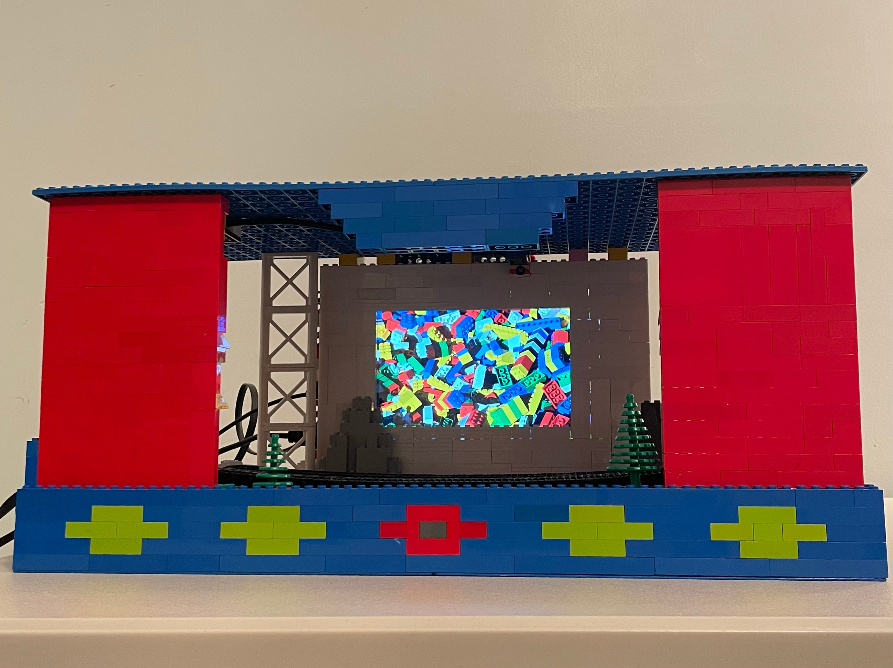

# LEGO AI Theater
Meet the world's first ever AI play theater! Ask it for any play and it will generate a performance based on your prompt.



## Table of Contents:
- [Overview](#overview)
- [Features](#features)
- [Building Instructions](#building-instructions)
- [Installation](#installation)
- [Usage](#usage)
- [Contributing](#contributing)
- [Troubleshooting](#troubleshooting)
- [License](#license)
- [Safety](#safety)

## Overview
This is the code necessary to run a Lego AI theater. It uses the ev3_dc library to control 4 Lego motors connected to a single LEGO EV3 hub. It also uses Google's Generative AI to generate a script that the Robot processes and performs. It can also *optionally* use a screen to display background images.

## Features
- Live movement through ev3_dc.
- Infinite play possibilities through built-in Google Gemini
- Speech for actors through edge_tts.
- *Optional* backgrounds with a second monitor.
- Two actors, one turning object and one flying object.
- Background music and sound effects through PyGame.
- Optional feedback for future improvements.
- Plays are saved (locally) for future playback.

## Building Instructions:
In this project, I have included a digital model named *theater_model.ldr*. You can open this model in Bricklink Studio (for Mac and Windows), or in LeoCAD (for Linux). The build instructions are slightly different than the original, but should work all the same and are completely compatible with the code.

Here is how the wires and motor should be connected:

|       | Actor 1 | Actor 2 | Turning Object | Flying Object |
|------|-----|-----|-----|-----|
| Port: | Port_B  | Port_C  | Port_A | Port_D |

*Note:* Actor 1 should be closer to the front of the stage, and Actor 2 should be behind Actor 1.

Also, make sure to connect the EV3 hub to your computer via USB or Bluetooth. The code will not work if the hub is not connected.

## Installation
### Requirements:
- Python 3 (Tested on 3.11)
- Python editor (Tested in VSCode)
- Speaker
- Extra monitor (*optional*)
- FFmpeg, including `ffplay`, for speech playback

### Installation:
1. Clone this project using Git:

```bash
git clone https://github.com/L-Magic-Code/LEGO-AI-THEATER.git
```
2. Install the required packages listed in requirements.txt:
```bash
cd LEGO-AI-THEATER # Enters the folder
pip install -r requirements.txt # Installs the required packages.
```
3. Install FFmpeg, which provides the `ffplay` command used for the actor's speech playback:

   - **Windows:** Download FFmpeg from [ffmpeg.org](https://ffmpeg.org/download.html), install it, and add its `bin` folder to `PATH`.
   - **macOS:** `brew install ffmpeg`
   - **Ubuntu/Debian:** `sudo apt install ffmpeg`

4. Get your API key [*here*](https://aistudio.google.com/api-keys)
5. Export your Gemini API key so the code can access it:
Mac/Linux:
```bash
export GEMINI_API_KEY="YOUR_API_KEY_HERE" # Lets the code access your API key. Replace with your actual Gemini API key.
```
Windows:
```bash
setx GEMINI_API_KEY "your_api_key_here" # Lets the code access your API key. Replace with your actual Gemini API key.
```

6. Open the project folder (on your computer) in your Python editor.
7. Look through config.json, and make changes as needed. (Look through the config_explanation.txt for a better explanation of the config file. Also, you may want to update the ai_prompt.txt to include your LEGO minifigures and objects. This will help the AI generate a more accurate script.)

## Usage
1. Open the project folder (on your computer) in your Python editor.
2. Open config.json.
3. If you want to generate a new play, make sure "script" is set to "gemini-generate". If you want to play a previously generated script, find it in the saved_scripts folder, and set "script" (in config) to the name of the old script file (not including the extension.)
4. Open main.py and run it.
5. If you are generating a new script, it will ask for a description of the play. Type it in the terminal and press enter.
6. If you are using the background screen, wait for the window to open with the "*STARTING SOON*" text. Drag it into the monitor you want to use, resize the window if needed, and press *c* on the keyboard (you have to click on the window before pressing c)
7. The actors will enter onstage. The terminal will load list of the minifigures it wants to use and where each should be put. Insert the minifigures and press *c* on the keyboard. (you have to click on the window before pressing c)
8. The actors will exit the stage. A voice will be played announcing the play.
9. After a few seconds, music will stop. A base drop will play. **Sit back and enjoy a fully automated LEGO play!**
10. After the play finishes, you may type feedback into the terminal. If you do not want to give feedback, simply type enter into the terminal and the code will stop. Note: Feedback is sent to AI to improve plays.

## Contributing
Contributions are accepted, and I appreciate your interest in my projects!

#### If you noticed a bug or have suggestion to improve the code:
1. Open the 'Issues' page under this repository [*here*](https://github.com/L-Magic-Code/LEGO-AI-THEATER/issues).
2. Check to see if anyone has already reported the issue you have. If someone already has posted the issue you have, you do not need to report it.
3. If nobody has reported the issue, click on "New Issue", describe the issue, and feel free to add context like the actual error text.

#### If you noticed a bug *AND* fixed it:
1. You can fork the Repository by clicking the "Fork" button at the top of this repository.
2. Add your changes in your forked repository that you just made. Try to keep the changes you make focused and explained.
3. Next, open the Pull Requests tab [*here*](https://github.com/L-Magic-Code/LEGO-AI-THEATER/pulls).
4. Click the green "New Pull Request" button. Please include what you changed, why you changed it, and how it will help this repository.

***Thank you for your feedback on this project!***


## Troubleshooting

1. **API Key Issues:** Ensure that your `GEMINI_API_KEY` was correctly exported in a environment variable.
2. **Config File Errors:** Double-check `config.json` for any syntax errors or missing fields.
3. **Background Screen Not Appearing:** Make sure the background screen is enabled in the config and that your system supports multiple monitors.
4. **Quiet or low audio:** Check your system's audio settings and ensure that the volume is not muted.
5. **Script Generation Errors:** If the script fails to generate, try providing a more detailed description or check your internet connection.
6. **Actor Movement Issues:** Ensure that the actor motors are connected properly and to the right ports. You may need to change the degrees that motors must rotate in the config.

*For bugs in the code, feel free to report it [here](#contributing).*

## License
This project is licensed under the [GPLv3 License](LICENSE). Contributions and modifications are welcome, but they must remain open-source and credit the original author.

## Safety
When using this code:
- Never openly expose your API key.
- Never enter personal info like passwords into Gemini.